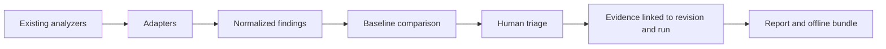

# Quality Audit Kit

**Evidence-driven software quality governance.**

> **Status: EXPERIMENTAL.** This repository contains a local Node.js CLI, draft data contracts, a dependency-free validation harness and a manually triggered optional GitHub Actions check. The package is packable as a private local npm tarball; it is not published, a dashboard is not provided, and no CleanMyMap scanner is extracted. Do not use it as a mature quality gate.

Quality Audit Kit is intended to connect the findings emitted by existing analyzers to explicit, reviewable decisions, baselines and reproducible evidence. Its purpose is **not** to replace ESLint, Knip, jscpd, Semgrep, SonarQube or similar tools.

## Install with your AI agent (Recommended)

```text
Install Quality Audit Kit from https://github.com/maxd4/quality-audit-kit into this project. Use the repository's current GitHub checkout method (do not use npm, because the package is not published), then run its `setup` command. Discover the real repository sources, create or reuse only the minimal quality-audit-kit.config.json and protected generic templates, run an initial read-only audit using existing analyzer reports or only analyzers already installed locally, and generate a Markdown report. If semantic personalization is needed, inspect the real sources and resume setup with an explicit answers JSON; do not install analyzers implicitly. Finish with the structured setup state and a concise report listing exact files, every command and check actually executed with its observed result, unavailable or unverified capabilities, missing information, precise second-pass questions, and remaining human confirmations. Do not modify application source, dependencies, baselines, thresholds or remotes, publish anything, or apply fixes without explicit approval.
```

## Install manually

```bash
git clone https://github.com/maxd4/quality-audit-kit.git
cd quality-audit-kit
PROJECT_DIR="/absolute/path/to/your-project"
node bin/quality-audit-kit.js init "$PROJECT_DIR"
node bin/quality-audit-kit.js scan "$PROJECT_DIR" --output "$PROJECT_DIR/quality-audit-kit.run.json"
node bin/quality-audit-kit.js report "$PROJECT_DIR/quality-audit-kit.run.json" --format markdown --output "$PROJECT_DIR/quality-audit-kit.report.md"
```

This current GitHub checkout is the supported installation path: the npm package is private and is not published. The commands require Git and Node.js 18 or newer. `init` creates the minimal configuration and protected generic templates; `scan` imports existing analyzer reports without installing dependencies; and `report` writes a local Markdown report. Replace `PROJECT_DIR` with the absolute path of the repository to audit. The default scan is read-only and reports unavailable analyzers explicitly.

## Why it exists

A quality scan answers what an analyzer found. A maintenance workflow also needs to answer:

- Is the finding new, historical, resolved, or reintroduced?
- Was the relevant check actually executed, or was it unavailable or skipped?
- Which repository revision and workspace did the finding represent?
- Who decided to fix, defer, or retain it, and on what evidence?
- Is a claimed fix backed by source inspection, an executed test, or integration proof?
- Can the analysis and its limitations be reviewed offline?

**Hypothesis, not proven market differentiation:** existing products cover parts of this workflow. A consistent evidence contract and human-triage lifecycle might still serve a useful niche. See [Landscape](docs/landscape.md) and [Evaluation](docs/evaluation.md).

## Proposed capabilities

| Capability | Planned stage | State in this repo |
| --- | --- | --- |
| Import existing analyzer output | MVP | Knip and jscpd JSON reports |
| Stable finding IDs and history | MVP | Stable IDs for the current normalized run |
| Baseline and new vs historical comparison | MVP | Implemented locally, experimental |
| Evidence-aware quality runs | MVP | Implemented draft run output with explicit measurement states |
| Human decisions and stale justification detection | MVP | Draft JSON Schema |
| JSON and Markdown reports | MVP | Implemented locally |
| Offline evidence bundles | MVP | Implemented locally, experimental |
| Deterministic correction planning | MVP | Implemented locally, experimental |
| Explainable threshold recommendations | MVP | Implemented locally, advisory |
| Official Agent Skill and resumable setup | Distribution preparation | Local `setup` orchestration and `skills/quality-audit-kit-setup/SKILL.md`; experimental |
| npm CLI | After MVP verification | Private local tarball with install/uninstall smoke test; not published |
| Optional GitHub Actions check | Distribution preparation | Manual-only workflow with `contents: read`; no dashboard or required remote service |
| Local SARIF 2.1.0 import/export and optional SonarQube connector | Implemented | Opt-in; no account required by other commands |
| Dependency graph and architectural radar | Later | Not implemented |

## Intended workflow



This repository installs no analyzer. A target repository's locally installed Knip or jscpd binary is executed only when the user passes `--run`.

## Use the local CLI

Requirements: Node.js 18 or newer. Runtime dependencies are not installed implicitly. The package intentionally remains `private` until a semver and cross-platform release decision is made.

For an agent-oriented first pass, use `node bin/quality-audit-kit.js setup /path/to/repository`. It writes a structured, resumable `quality-audit-kit.setup.json` state and reuses the run/report artifacts on `setup --resume`; `--answers file` applies only explicit, validated generated-block content. The setup workflow is offline by default and does not require an AI provider.

Additional local workflows:

```bash
node bin/quality-audit-kit.js scan /path/to/repository --run=knip,jscpd --output run.json
node bin/quality-audit-kit.js baseline run.json --output quality-audit-kit.baseline.json
node bin/quality-audit-kit.js triage run.json --baseline quality-audit-kit.baseline.json
node bin/quality-audit-kit.js report run.json
node bin/quality-audit-kit.js report run.json --format json --output report.json
node bin/quality-audit-kit.js clones run.json --format markdown --output clones.md
node bin/quality-audit-kit.js clones run.json --format json --output clones.json --export clone-prompts
node bin/quality-audit-kit.js scan /path/to/repository --sarif-report report.sarif --output run.json
node bin/quality-audit-kit.js report run.json --format sarif --output report.sarif
node bin/quality-audit-kit.js connect sonar --sonar-url https://sonar.example --sonar-project project-key
node bin/quality-audit-kit.js import sonar /path/to/repository --sonar-url https://sonar.example --sonar-project project-key --sonar-token-env SONAR_TOKEN --output sonar-run.json
node bin/quality-audit-kit.js import sonar-export sonarqube-export.json --repository /path/to/repository --output sonar-run.json
node bin/quality-audit-kit.js report run.json --format zip --output quality-audit-kit-run.zip
node bin/quality-audit-kit.js report --verify-bundle quality-audit-kit-run.zip
node bin/quality-audit-kit.js plan run.json --output quality-audit-kit.plan.json
node bin/quality-audit-kit.js plan --next quality-audit-kit.plan.json
node bin/quality-audit-kit.js plan --export quality-audit-kit.plan.json --output codex-prompts
node bin/quality-audit-kit.js fix --next quality-audit-kit.plan.json
node bin/quality-audit-kit.js fix --next quality-audit-kit.plan.json --execute --approve --output fix-result.json
node bin/quality-audit-kit.js verify fix-result.json
node bin/quality-audit-kit.js thresholds recommend run.json --output threshold-recommendations.json --export proposed-thresholds.json
# Normative mutation requires an explicit approval flag:
node bin/quality-audit-kit.js thresholds recommend run.json --apply --approve --profile balanced
```

For a minimal hand-written configuration, copy [examples/quality-audit-kit.config.example.json](examples/quality-audit-kit.config.example.json) to `quality-audit-kit.config.json`. `init` creates the same functional defaults plus protected project templates.

To test the local npm distribution without publishing anything:

```bash
npm pack --ignore-scripts
npm run test:package
```

`npm run test:package` packs the allowlisted files, installs the tarball into an isolated temporary consumer with network access disabled, runs the installed binary, and uninstalls it. It does not call `npm publish`.

`init` writes an explicit `quality-audit-kit.config.json` and creates generic, protected `PROJECT_HANDOFF.md` and `COMMIT_REVIEW.md` templates in the target repository. It detects actual files, configurations, documentation, tests and rules; unproven fields remain `UNKNOWN`. Re-running `init` is safe: existing documents are protected, while `--update-templates --preview` shows a deterministic diff and `--update-templates` refreshes only managed generated blocks. `context refresh` updates only stale detected facts and controls, preserves human decisions and reports contradictions instead of rewriting instructions. `--agent codex` prepares an optional, explicit Codex customization handoff; the CLI never executes an agent or installs dependencies implicitly. `scan` writes JSON to stdout unless `--output` is provided, and does not modify analyzed source files. Existing `knip-report.json` and `jscpd-report.json` files are imported automatically; `--run` executes only locally installed scanner binaries and never installs dependencies. An absent, skipped or failed scanner remains visible as `NOT_MEASURED` or `FAILURE`; it is never treated as a clean result. `baseline` requires a complete measured run, `triage` preserves evidence-backed decisions, and `scan --baseline` refuses incomplete comparisons and applies the configured ratchet without changing the baseline implicitly. See [CLI usage and contracts](docs/cli.md).

`report` emits a readable terminal summary by default, deterministic Markdown or structured JSON on request, and an optional offline ZIP with `manifest.json`, `inventory.json`, `checksums.sha256` and an offline verification command. It never computes a global quality score, refuses output overwrites, and bundles only normalized evidence plus explicitly authorized non-source evidence files.

`clones` reuses the jscpd findings already present in a run; it never reruns jscpd and never edits source code. It groups only compatible native fingerprints or precise derived pair characteristics, deduplicates inverted pairs and overlapping line ranges, and reports `REVIEW_REQUIRED` by default because syntactic similarity is not semantic proof. Missing paths, ranges or metrics remain diagnostics. Human decisions can justify `KEEP_JUSTIFIED` or `NO_ACTION_NOISE`; no deletion, refactor or quantified gain is inferred automatically. See [clone audit example](examples/clones.example.json).

SARIF 2.1.0 import/export is local and does not require an account. SonarQube is an optional official-Web-API connector: it detects the server version, imports paginated issues and analysis metadata with a bounded limit, and keeps the Sonar analysis revision separate from the local Git context SHA. Tokens are read from an environment variable or a file outside the analyzed repository and are never written to runs, logs or offline bundles. Other commands remain usable without SonarQube or any external account.

`plan` creates deterministic correction lots and autonomous Codex prompts from one run. It orders security confirmations, regressions, broken contracts, structural causes, actionable debt and secondary improvements with an explicit rule based on category, severity, confidence, finding count, known consumers, change risk, cost and stable lot ID; it does not calculate an opaque score. Common-cause grouping requires explicit evidence. `plan --next` selects only a safe next lot, while `plan --export` writes one prompt per lot. Uncertain findings, stale decisions, incomplete measurements, unsupported relations and dependency cycles remain visible and can block selection.

`thresholds recommend` is a local, advisory policy counselor. It separates current measurements, recommended objectives and historical ratchet caps by metric, language, workspace and file category, and reports distributions, quantiles, extremes, exceedances, findings affected, confidence and application consequences. Progressive, balanced and strict profiles use explainable median/low-quantile/extreme rules; high quantiles are descriptive and are never promoted automatically from a degraded repository. Generated files, failed or unavailable scanners and insufficient samples remain excluded or explicitly uncertain. `--export` writes an approval-required proposal; only `--apply --approve` can modify normative configuration. No global quality score is computed.

`fix --next` presents the next bounded correction lot without mutation. Agent execution is opt-in through `--execute --approve`; the Codex and command adapters are refused unless a strong platform confinement mechanism is supplied, while the built-in deterministic adapter uses a physical no-symlink repository allowlist. The workflow protects pre-existing approved files, observes Git plus ignored repository files, refuses commits/pushes/deletions/baseline changes, and records that external effects remain unobservable. Validation scripts require `--authorize-validation`, an exact script hash and an explicit no-write/no-network effect declaration; names such as `test` or `lint` are not safety evidence. `verify` checks that evidence without executing an agent. This remains an experimental local workflow, not an operational autonomous repair service.

## Read the project

- [Vision and principles](docs/vision.md)
- [Landscape and alternatives](docs/landscape.md)
- [Proposed architecture](docs/architecture.md)
- [Draft data contracts](docs/contracts.md)
- [CLI usage and contracts](docs/cli.md)
- [Official setup Agent Skill](skills/quality-audit-kit-setup/SKILL.md)
- [Initialization templates](docs/templates.md)
- [MVP specification](docs/mvp.md)
- [Roadmap and exit criteria](docs/roadmap.md)
- [Evaluation protocol](docs/evaluation.md)
- [Origin and extraction boundaries](docs/provenance.md)
- [Licensing and contribution boundaries](docs/licensing.md)

The [example run](examples/run.example.json) and [decision records](examples/decisions.example.json) are **entirely fictional**. JSON Schemas are under `schemas/`. Run the dependency-free consistency checks with:

```bash
python3 tools/validate_examples.py
```

The Python harness checks a small set of cross-file invariants, `npm test` runs real CLI integration tests for report import, stable IDs, discovery, negative measurement states, historical comparison, triage and ratchets, and `npm run test:package` checks local installation and removal. `node tools/measure-workflows.js` provides a read-only, two-repository measurement harness; its observed scope and limits are recorded in [Evaluation](docs/evaluation.md). The optional manual workflow in `.github/workflows/fixtures.yml` repeats these checks on Ubuntu for Node 18 and 20 with only `contents: read`; it is not a required service and does not publish results to a dashboard. Neither local nor CI checks are a universal quality gate for the analyzed repository; incomplete or unverified audits remain `NOT_EVALUATED`.

## Optional GitHub Actions integration

The repository includes a manual-only workflow. Run it from the Actions tab when GitHub is part of the project workflow; otherwise use the same local commands. It uses `actions/checkout` with credentials persistence disabled, requests only `contents: read`, and performs no deployment, issue creation, code-scanning upload or dashboard publication.

## Relationship to CleanMyMap

The design was informed by an existing quality-audit workflow in [CleanMyMap](https://github.com/maxd4/CleanmyMap). CleanMyMap has its own runner and repository-specific policies. **No CleanMyMap source code, real audit artifacts, baselines, secrets, user data or internal registry has been copied here.** Historical observations and links are in [provenance](docs/provenance.md). The two projects are independent; a future integration would be optional.

## License

Original materials in this repository are offered under [Apache License 2.0](LICENSE), SPDX `Apache-2.0`. This license does **not** automatically relicense any CleanMyMap code (which is published under `AGPL-3.0-only`) or any third-party analyzer. See [licensing](docs/licensing.md).

## Contributing

Discussions about intended contracts and testable use cases are welcome. Follow [CONTRIBUTING.md](CONTRIBUTING.md). Before proposing a broad architecture or scanner integration, open an issue describing a concrete cross-repository use case.
