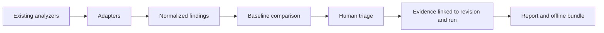

# Quality Audit Kit

**Evidence-driven software quality governance.**

> **Status: EXPERIMENTAL.** This repository contains a first local Node.js CLI, draft data contracts and a dependency-free validation harness. It is not yet a published npm package, GitHub Action, dashboard or extracted CleanMyMap scanner. Do not use it as a mature quality gate.

Quality Audit Kit is intended to connect the findings emitted by existing analyzers to explicit, reviewable decisions, baselines and reproducible evidence. Its purpose is **not** to replace ESLint, Knip, jscpd, Semgrep, SonarQube or similar tools.

## Why it exists

A quality scan answers what an analyzer found. A maintenance workflow also needs to answer:

- Is the finding new, historical, resolved, or reintroduced?
- Was the relevant check actually executed, or was it unavailable or skipped?
- Which repository revision and workspace did the finding represent?
- Who decided to fix, defer, or retain it, and on what evidence?
- Is a claimed fix backed by source inspection, an executed test, or integration proof?
- Can the analysis and its limitations be reviewed offline?

**Hypothesis, not proven market differentiation:** existing products cover parts of this workflow. A consistent evidence contract and human-triage lifecycle might still serve a useful niche. See [Landscape](docs/landscape.md) and [Evaluation](docs/evaluation.md).

## Proposed capabilities

| Capability | Planned stage | State in this repo |
| --- | --- | --- |
| Import existing analyzer output | MVP | Knip and jscpd JSON reports |
| Stable finding IDs and history | MVP | Stable IDs for the current normalized run |
| Baseline and new vs historical comparison | MVP | Implemented locally, experimental |
| Evidence-aware quality runs | MVP | Implemented draft run output with explicit measurement states |
| Human decisions and stale justification detection | MVP | Draft JSON Schema |
| JSON and Markdown reports | MVP | Implemented locally |
| Offline evidence bundles | MVP | Implemented locally, experimental |
| Deterministic correction planning | MVP | Implemented locally, experimental |
| Explainable threshold recommendations | MVP | Implemented locally, advisory |
| npm CLI | After MVP verification | Local package prototype; not published |
| Local SARIF 2.1.0 import/export and optional SonarQube connector | Implemented | Opt-in; no account required by other commands |
| Dependency graph and architectural radar | Later | Not implemented |

## Intended workflow



This repository installs no analyzer. A target repository's locally installed Knip or jscpd binary is executed only when the user passes `--run`.

## Start the local CLI

Requirements: Node.js 18 or newer. Runtime dependencies are not installed implicitly.

From this repository:

```bash
node bin/quality-audit-kit.js init /path/to/repository
node bin/quality-audit-kit.js scan /path/to/repository --output run.json
node bin/quality-audit-kit.js scan /path/to/repository --run=knip,jscpd --output run.json
node bin/quality-audit-kit.js baseline run.json --output quality-audit-kit.baseline.json
node bin/quality-audit-kit.js triage run.json --baseline quality-audit-kit.baseline.json
node bin/quality-audit-kit.js report run.json
node bin/quality-audit-kit.js report run.json --format markdown --output report.md
node bin/quality-audit-kit.js report run.json --format json --output report.json
node bin/quality-audit-kit.js scan /path/to/repository --sarif-report report.sarif --output run.json
node bin/quality-audit-kit.js report run.json --format sarif --output report.sarif
node bin/quality-audit-kit.js connect sonar --sonar-url https://sonar.example --sonar-project project-key
node bin/quality-audit-kit.js import sonar /path/to/repository --sonar-url https://sonar.example --sonar-project project-key --sonar-token-env SONAR_TOKEN --output sonar-run.json
node bin/quality-audit-kit.js report run.json --format zip --output quality-audit-kit-run.zip
node bin/quality-audit-kit.js report --verify-bundle quality-audit-kit-run.zip
node bin/quality-audit-kit.js plan run.json --output quality-audit-kit.plan.json
node bin/quality-audit-kit.js plan --next quality-audit-kit.plan.json
node bin/quality-audit-kit.js plan --export quality-audit-kit.plan.json --output codex-prompts
node bin/quality-audit-kit.js fix --next quality-audit-kit.plan.json
node bin/quality-audit-kit.js fix --next quality-audit-kit.plan.json --execute --approve --output fix-result.json
node bin/quality-audit-kit.js verify fix-result.json
node bin/quality-audit-kit.js thresholds recommend run.json --output threshold-recommendations.json --export proposed-thresholds.json
# Normative mutation requires an explicit approval flag:
node bin/quality-audit-kit.js thresholds recommend run.json --apply --approve --profile balanced
```

`init` writes an explicit `quality-audit-kit.config.json` and creates generic, protected `PROJECT_HANDOFF.md` and `COMMIT_REVIEW.md` templates in the target repository. It detects actual files, configurations, documentation, tests and rules; unproven fields remain `UNKNOWN`. Re-running `init` is safe: existing documents are protected, while `--update-templates --preview` shows a deterministic diff and `--update-templates` refreshes only managed generated blocks. `context refresh` updates only stale detected facts and controls, preserves human decisions and reports contradictions instead of rewriting instructions. `--agent codex` prepares an optional, explicit Codex customization handoff; the CLI never executes an agent or installs dependencies implicitly. `scan` writes JSON to stdout unless `--output` is provided, and does not modify analyzed source files. Existing `knip-report.json` and `jscpd-report.json` files are imported automatically; `--run` executes only locally installed scanner binaries and never installs dependencies. An absent, skipped or failed scanner remains visible as `NOT_MEASURED` or `FAILURE`; it is never treated as a clean result. `baseline` requires a complete measured run, `triage` preserves evidence-backed decisions, and `scan --baseline` refuses incomplete comparisons and applies the configured ratchet without changing the baseline implicitly. See [CLI usage and contracts](docs/cli.md).

`report` emits a readable terminal summary by default, deterministic Markdown or structured JSON on request, and an optional offline ZIP with `manifest.json`, `inventory.json`, `checksums.sha256` and an offline verification command. It never computes a global quality score, refuses output overwrites, and bundles only normalized evidence plus explicitly authorized non-source evidence files.

SARIF 2.1.0 import/export is local and does not require an account. SonarQube is an optional official-Web-API connector: it detects the server version, imports paginated issues and analysis metadata with a bounded limit, and keeps the Sonar analysis revision separate from the local Git context SHA. Tokens are read from an environment variable or a file outside the analyzed repository and are never written to runs, logs or offline bundles. Other commands remain usable without SonarQube or any external account.

`plan` creates deterministic correction lots and autonomous Codex prompts from one run. It orders security confirmations, regressions, broken contracts, structural causes, actionable debt and secondary improvements with an explicit rule based on category, severity, confidence, finding count, known consumers, change risk, cost and stable lot ID; it does not calculate an opaque score. Common-cause grouping requires explicit evidence. `plan --next` selects only a safe next lot, while `plan --export` writes one prompt per lot. Uncertain findings, stale decisions, incomplete measurements, unsupported relations and dependency cycles remain visible and can block selection.

`thresholds recommend` is a local, advisory policy counselor. It separates current measurements, recommended objectives and historical ratchet caps by metric, language, workspace and file category, and reports distributions, quantiles, extremes, exceedances, findings affected, confidence and application consequences. Progressive, balanced and strict profiles use explainable median/low-quantile/extreme rules; high quantiles are descriptive and are never promoted automatically from a degraded repository. Generated files, failed or unavailable scanners and insufficient samples remain excluded or explicitly uncertain. `--export` writes an approval-required proposal; only `--apply --approve` can modify normative configuration. No global quality score is computed.

`fix --next` presents the next bounded correction lot without mutation. Agent execution is opt-in through `--execute --approve`; the default adapter invokes a locally installed Codex CLI in an ephemeral workspace-write session, while a minimal command adapter remains available for other local agents. The workflow protects pre-existing approved files, audits all changed paths, refuses commits/pushes/deletions/baseline changes, re-runs the targeted scanners and safe validations, and records only redacted evidence. `verify` checks that evidence without executing an agent. This remains an experimental local workflow, not an operational autonomous repair service.

## Read the project

- [Vision and principles](docs/vision.md)
- [Landscape and alternatives](docs/landscape.md)
- [Proposed architecture](docs/architecture.md)
- [Draft data contracts](docs/contracts.md)
- [CLI usage and contracts](docs/cli.md)
- [Initialization templates](docs/templates.md)
- [MVP specification](docs/mvp.md)
- [Roadmap and exit criteria](docs/roadmap.md)
- [Evaluation protocol](docs/evaluation.md)
- [Origin and extraction boundaries](docs/provenance.md)
- [Licensing and contribution boundaries](docs/licensing.md)

The [example run](examples/run.example.json) and [decision records](examples/decisions.example.json) are **entirely fictional**. JSON Schemas are under `schemas/`. Run the dependency-free consistency checks with:

```bash
python3 tools/validate_examples.py
```

The Python harness checks a small set of cross-file invariants, while `npm test` runs real CLI integration tests for report import, stable IDs, discovery, negative measurement states, historical comparison, triage and ratchets. Neither is a universal quality gate for the analyzed repository; incomplete or unverified audits remain `NOT_EVALUATED`.

## Relationship to CleanMyMap

The design was informed by an existing quality-audit workflow in [CleanMyMap](https://github.com/maxd4/CleanmyMap). CleanMyMap has its own runner and repository-specific policies. **No CleanMyMap source code, real audit artifacts, baselines, secrets, user data or internal registry has been copied here.** Historical observations and links are in [provenance](docs/provenance.md). The two projects are independent; a future integration would be optional.

## License

Original materials in this repository are offered under [Apache License 2.0](LICENSE), SPDX `Apache-2.0`. This license does **not** automatically relicense any CleanMyMap code (which is published under `AGPL-3.0-only`) or any third-party analyzer. See [licensing](docs/licensing.md).

## Contributing

Discussions about intended contracts and testable use cases are welcome. Follow [CONTRIBUTING.md](CONTRIBUTING.md). Before proposing a broad architecture or scanner integration, open an issue describing a concrete cross-repository use case.
