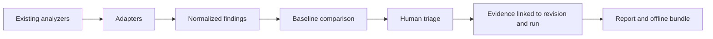

# Quality Audit Kit

**Evidence-driven software quality governance.**

> **Status: DESIGN / EXPERIMENTAL.** This repository currently publishes the project specification, draft data contracts and a small validation harness. It does **not** contain a distributable quality-audit CLI, npm package, GitHub Action, or extracted CleanMyMap scanner. Do not use it as a working quality gate.

Quality Audit Kit is intended to connect the findings emitted by existing analyzers to explicit, reviewable decisions, baselines and reproducible evidence. Its purpose is **not** to replace ESLint, Knip, jscpd, Semgrep, SonarQube or similar tools.

## Why it exists

A quality scan answers what an analyzer found. A maintenance workflow also needs to answer:

- Is the finding new, historical, resolved, or reintroduced?
- Was the relevant check actually executed, or was it unavailable or skipped?
- Which repository revision and workspace did the finding represent?
- Who decided to fix, defer, or retain it, and on what evidence?
- Is a claimed fix backed by source inspection, an executed test, or integration proof?
- Can the analysis and its limitations be reviewed offline?

**Hypothesis, not proven market differentiation:** existing products cover parts of this workflow. A consistent evidence contract and human-triage lifecycle might still serve a useful niche. See [Landscape](docs/landscape.md) and [Evaluation](docs/evaluation.md).

## Proposed capabilities

| Capability | Planned stage | State in this repo |
| --- | --- | --- |
| Import existing analyzer output | MVP | Specified, not implemented |
| Stable finding IDs and history | MVP | Draft contract only |
| Baseline and new vs historical comparison | MVP | Specified, not implemented |
| Evidence-aware quality runs | MVP | Draft JSON Schema |
| Human decisions and stale justification detection | MVP | Draft JSON Schema |
| JSON and Markdown reports | MVP | Specified, not implemented |
| Offline evidence bundles | MVP | Specified, not implemented |
| npm CLI | After MVP verification | Not implemented |
| GitHub Actions and SARIF export | Later | Not implemented |
| Dependency graph and architectural radar | Later | Not implemented |

## Intended workflow



No analyzer is installed or executed by this initial repository.

## Read the project

- [Vision and principles](docs/vision.md)
- [Landscape and alternatives](docs/landscape.md)
- [Proposed architecture](docs/architecture.md)
- [Draft data contracts](docs/contracts.md)
- [MVP specification](docs/mvp.md)
- [Roadmap and exit criteria](docs/roadmap.md)
- [Evaluation protocol](docs/evaluation.md)
- [Origin and extraction boundaries](docs/provenance.md)
- [Licensing and contribution boundaries](docs/licensing.md)

The [example run](examples/run.example.json) and [decision records](examples/decisions.example.json) are **entirely fictional**. JSON Schemas are under `schemas/`. Run the dependency-free consistency checks with:

```bash
python3 tools/validate_examples.py
```

The harness checks a small set of cross-file invariants; it does **not** constitute a complete JSON Schema validator or a functional CLI test.

## Relationship to CleanMyMap

The design was informed by an existing quality-audit workflow in [CleanMyMap](https://github.com/maxd4/CleanmyMap). CleanMyMap has its own runner and repository-specific policies. **No CleanMyMap source code, real audit artifacts, baselines, secrets, user data or internal registry has been copied here.** Historical observations and links are in [provenance](docs/provenance.md). The two projects are independent; a future integration would be optional.

## License

Original materials in this repository are offered under [Apache License 2.0](LICENSE), SPDX `Apache-2.0`. This license does **not** automatically relicense any CleanMyMap code (which is published under `AGPL-3.0-only`) or any third-party analyzer. See [licensing](docs/licensing.md).

## Contributing

Discussions about intended contracts and testable use cases are welcome. Follow [CONTRIBUTING.md](CONTRIBUTING.md). Before proposing a broad architecture or scanner integration, open an issue describing a concrete cross-repository use case.
